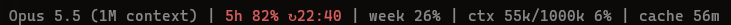

# claude-code-usage-clock

Claude Code shows you your usage. This makes the model see it too, and lets two gates decide from those numbers
whether new agents may start and running ones keep working.

A first install runs the gates in shadow mode: nothing is blocked yet, and the model tells you each time a gate
would have stepped in. Switch to `enforce` once the log looks right ([From shadow to enforce](#from-shadow-to-enforce)).


The status line in a real session: the five-hour window at 57 % (yellow from 50 %) resets at 22:40, the week is
at 23 %, the context holds 485k of 1000k tokens (yellow from 300k), and the prompt cache stays warm for another
58 minutes.

Claude Code knows your plan limits, but the model working for you does not. It cannot tell whether starting
ten agents at 80 % of the five-hour window is a good idea, it does not know that it is 3 a.m., and an
overnight run happily spends the whole window. It cannot see how full its own context window is either. This
repo closes that gap with a status line and four hooks (five parts):

| Part | What it does | Maturity | Default |
|---|---|---|---|
| **Status line** | Shows model, 5h and weekly usage, the context size and the prompt cache clock in colour. Several sessions merge into one shared usage file, so every session and every hook sees the same, current numbers. | stable | on |
| **Usage clock** (`UserPromptSubmit`) | Adds one line of context to every prompt: usage, reset times, and the local date and time. Both parts switch independently. | stable | on |
| **Context reporter** (`UserPromptSubmit`, `PostToolUse`) | Tells the model how full its context window is, from the numbers the status line measured: with every prompt, and after a tool call once the context is half full. Needs the status line; subagents get nothing. | available | on |
| **Spawn gate** (`PreToolUse`: Agent, Workflow, Skill) | Stops new agent blocks above a usage threshold, and checks that every agent has a determinable model and effort (reports by default, can deny). | available | log only |
| **Soft stop** (`PreToolUse`: all tools) | Slows subagents down near the five-hour limit: warn, then only allow saving a checkpoint, then ask them to finish with a partial result. Never blocks the main session. | available | log only |

On top of these there is one optional helper that needs no settings entry: the [wake-up
watcher](#the-wake-up-watcher), off by default.

"Log only" (`shadow` mode) means the gates decide and write their decision to a log, but block nothing. When a
gate would have denied, asked or warned, the model gets a short note instead ("Spawn gate (shadow mode, information
only): in enforce mode this start would have been denied. Reason: …") and tells you, or a subagent mentions it
in its report. Run them that way for a while, read the log, then switch to `enforce`.

## Requirements

- Claude Code on a **Pro or Max** subscription. The usage numbers come from the `rate_limits` field that
  Claude Code passes to the status line; API key, Bedrock and Vertex sessions do not get it, and neither does
  a session before its first response. Without it everything reports usage as `unknown`.
- Python 3.10 or newer as `python3` (the macOS system Python 3.9 is too old; install a current one).
- Linux or macOS. Windows is not supported (`fcntl`).
- No third-party packages at runtime.

## Install

```sh
git clone https://github.com/inoX-Network/claude-code-usage-clock
cd claude-code-usage-clock
python3 tools/install.py --dry-run     # shows what would change
python3 tools/install.py               # installs all five parts, gates in shadow mode
```

The installer copies the scripts to `~/.claude/hooks/usage-clock/`, creates `config.json` there if it does not
exist yet, and adds the hooks and the status line to `~/.claude/settings.json`. Before writing it runs each
hook it installs once as a smoke test and keeps a backup (`settings.json.bak-usage-clock-<timestamp>`). Running it again
updates the entries instead of adding duplicates.

The installer recognises its own entries by the full path of the script in `--target`, not by the file name.
A hook of someone else that happens to run a script with the same name is left alone and named in the output.
If you move `--target`, the entries of the old place stay too; remove them with `--uninstall --target OLD`.

Every run rewrites the entries of the selected components from its options. Two options behave differently
when you leave them out:

- `--mode`: the mode of the entries that are already installed is kept (`shadow` on a first install). The
  output line `Mode:` says which mode applies and where it comes from.
- `--week-ok-until`: it is **not** kept. A run without it removes an earlier approval, and the output says
  so. Pass it again to keep it.

Options:

| Option | Meaning |
|---|---|
| `--components statusline,usage-clock,context-reporter,spawn-gate,soft-stop` | Install only some parts. The context reporter adds two entries (`UserPromptSubmit` and `PostToolUse`) and says nothing without the status line. |
| `--mode shadow\|enforce` | Mode of the two gates. Without it an existing installation keeps its mode; a first install starts in `shadow`. |
| `--week-ok-until YYYY-MM-DD` | Allow new blocks above the weekly threshold up to and including that day. Not kept: a run without it removes an earlier value (and says so). Needs the component `spawn-gate`. |
| `--replace-statusline` | Replace an existing status line of your own. Without it, yours is left alone, but then nothing writes the shared usage file and every hook sees the usage as `unknown`. Needs the component `statusline`. |
| `--auto-continue` | Also set `autoContinueAtUsageLimit: true` (Claude Code waits and continues after a reset). |
| `--settings PATH`, `--target DIR` | Other locations. |
| `--dry-run` | Show what would change and write nothing. |
| `--uninstall` | Remove the entries again; files stay. See [Uninstall completely](#uninstall-completely). |

Restart Claude Code (or open `/hooks`) after installing.

### Uninstall completely

`python3 tools/install.py --uninstall` removes the hook entries and the status line entry that point to the
scripts in `--target` (with a backup of `settings.json`). It deletes no files and does not undo everything else
the installer did. What stays, and how to remove it:

| What stays | How to remove it |
|---|---|
| The `--target` folder (default `~/.claude/hooks/usage-clock/`) with the scripts and your `config.json` | `rm -r ~/.claude/hooks/usage-clock` (or the folder you gave with `--target`) |
| The log folder (`log_dir`, default `~/.cache/claude-usage-clock/`): `log.jsonl`, the per-agent counters, the per-session context files, the measurement history (`usage-history.jsonl` and `usage-history.jsonl.1`), the report archive (`usage-days.jsonl`) and the lock of the usage file (`rate-limit.json.lock`) | `rm -r ~/.cache/claude-usage-clock` |
| The shared usage file `~/.claude/rate-limit.json` (the `usage_file` in your config); versions before October 2026 also left its lock file next to it | `rm ~/.claude/rate-limit.json ~/.claude/rate-limit.json.lock` |
| `autoContinueAtUsageLimit: true`, if you installed with `--auto-continue` | Remove the key from `settings.json` by hand, or set it to `false`. |
| Your earlier status line, if you installed with `--replace-statusline`: it is **not** restored | Copy it back from the backup `settings.json.bak-usage-clock-<timestamp>` that the installing run printed (the `Undo:` line). |
| The backups `settings.json.bak-usage-clock-*` | Delete them when you no longer need them. |

If you use `--components`, the uninstall removes only the components you name.

## What the model sees

With every prompt:

```
Usage: 5h 40 % (resets 14:00) · week 61 % (resets Mon 19 Jan 09:00) · measured 0 min ago · Now: Wed 14 Jan 2026 10:05
```

At or above `start_block_5h` the line says so (`— from 75 % on, no new blocks`). At or above `start_block_week` it
adds a weekly note that follows `thresholds.week_action`: `week at or above 75 %: agents start with a warning`
(`warn`), `…: new agents need the user's approval` (`ask`) or `…: no new agents without --week-ok-until` (`deny`).
Both notes can stand together. With a missing or old measurement it says `unknown` or `STALE` and
asks to start larger blocks only after a fresh measurement. Without a weekly value it shows `week ?`, and a
measurement stamped slightly ahead of your clock shows `measured in the future`. The texts are English; the
model relays them to you in your language.

The time part is useful on its own: every message in the transcript carries its date and time, so you can
find later when something happened. Turn either part off in `config.json` (`display.show_usage`,
`display.show_time`).

### The context window

```
Context: 168k/1000k tokens (17%). Measured, not estimated.
```

The context reporter adds this line to every prompt, and after a tool call once the context has reached
`context_reporter.after_tool_from` (default 50 %) of the window, so a long run is reminded as the context gets
expensive and not after every single call. The numbers are those of the `ctx` part of the status line, with the
tokens cut to thousands and the percentage rounded the same way. Without them the model can only guess how full
its context is.

It reads nothing but the per-session file the status line writes (see below), never the transcript. It stays
silent, and says nothing at all, when:

- the status line is not installed, or has not measured this session yet (before the first answer),
- the measurement is older than `context_reporter.max_age_min` (default 15 minutes) or from the future,
- the file is missing, broken, a link, or belongs to another session,
- the call comes from a subagent: its context is another one, and the file describes the main session.

Several sessions at once each get their own numbers. The texts are English; the model relays them to you in
your language.

### The wake-up watcher

A model does nothing while you are away, but the prompt cache stays warm for up to an hour. If you leave a long
session without saying goodbye, the cache goes cold and the next message writes the whole context again. The
wake-up watcher uses the warm cache: shortly before it expires it wakes the model, which then runs its
session-end routine (save progress, commit, push, summary) while the context is still cheap to read.

It is off by default. Switch it on by setting `wake_watcher.from_k` to the context size (in thousands of tokens)
from which you want it, for example `200`. From then on the context reporter adds one sentence to the prompt line:
the model starts `wake_watcher.py` once in the background (it is copied by the installer, no settings entry). The
watcher checks once a minute and ends with a message, which Claude Code hands to the model as the result of the
background task:

- It fires when the context has reached `from_k`, the cache is warm, and the cache expires within the lead time:
  `wake_watcher.lead_min` (default 10 minutes), but at most a fifth of the cache lifetime, so 10 minutes for the
  1-hour cache and 1 minute for the 5-minute cache. The message says how long you were away, how much cache is left
  and the context size, and tells the model to run its session-end routine without asking and not to start another
  watcher.
- A cold or unknown cache never fires: waking a cold cache would write the whole context again, which is what it
  is meant to avoid. When you write, the expiry moves and the watcher waits on.
- It stops with a short message that asks for nothing (Claude Code still delivers it, after `/clear` to the new
  session) when the session is gone (after `/clear` or closing it: no fresh state file on
  three checks in a row; a sleeping computer does not count), after 115 minutes (Claude Code ends background tasks
  after two hours; the turn that delivers its message already offers the next one), when another watcher for the
  session lives, or when `from_k` is 0.
- After a wake-up the offer rests for an hour, so the routine does not start the next watcher.

What you need for this:

- The status line, with its `refreshInterval` (the installer sets 60 seconds). The watcher reads the cache clock
  from the state file the status line writes; without refreshing it would see an idle session as gone.
- A **session-end routine**: what "save progress, commit, push, summary" means for your projects. The wake-up
  message alone is the output of a tool, and a model rightly does not follow instructions from tool output on its
  own. Two ways to close that gap:
  - Put the routine in a file and set `wake_watcher.routine_file` to its path. When the watcher fires, Claude Code
    submits its end as a notification, which runs the context reporter; it sees that the task's output is this
    session's wake-up call and adds your file to the context, as hook context like the context line. The file must
    be a regular file of yours that group and others cannot write, UTF-8, at most 4 KB; otherwise nothing is added
    and the log gets one line. [`examples/wake-routine.md`](examples/wake-routine.md) is a start; the installer
    does not copy it, so an update never touches your file.
  - Or write it into the instructions the model reads (for example your `CLAUDE.md`), with one line that names the
    wake-up call as a trigger for the routine.
- Only the main session is offered the watcher, never a subagent, and only with a prompt, never after a tool call.

## What the status line shows

```
Opus | 5h 40% ↻14:00 | week 61% ↻Mon 09:00 | ctx 231k/1000k 23% | cache 54m
```



Later the same evening: the five-hour window has passed 75 % and turns red. With the default thresholds the
spawn gate now starts no new agent blocks until the window resets at 22:40.

- `5h` and `week` come from `rate_limits` (yellow from 50 %, red from 75 %); at the weekly threshold
  `<- weekly limit reached` follows.
- `↻14:00` is when the window resets, in your local time. The weekly one carries the weekday and appears only
  from yellow on; below that it is days away. A missing or past reset time is left out
  (`statusline.show_reset`).
- `ctx` is the input context of the session: tokens used, window size, share of the window. It is shown from
  the first prompt on, as soon as Claude Code reports the window size; before the first answer it reads `ctx –/1000k` instead of a made-up zero. The colour
  depends on the absolute tokens, not on the percentage: yellow from 300k, red from 500k
  (`statusline.context_yellow_from_k`, `context_red_from_k`), because a long context costs the same on a small
  and on a large window.
- `cache` is how long the prompt cache of the session stays warm: minutes left, yellow below 5
  (`statusline.cache_yellow_below_min`), red `cache cold` when it has run out or is not warm. Nothing is shown
  until the first request.
- A part whose input is missing is left out, never filled with a guess.

While a context is measured, the status line also writes `<log_dir>/context/<session_id>.json` (window size,
used tokens, time, and while the prompt cache is warm its lifetime and expiry) for each session, private to you
(mode 0600) and cleaned up after 7 days. The context reporter and the wake-up watcher read that file; without the
status line there is nothing for them to read.

It also keeps a **measurement history** of the usage numbers, `<log_dir>/usage-history.jsonl`, for reports over
days, weeks and months. One line per measurement, numbers only (no session, no path):
`{"t":"2026-01-14T10:05:00Z","five":40,"week":61,"five_resets":1768399200,"week_resets":1768813200}`. A line is
added when `five`, `week` or a reset time changed since the last line, or when the last line is
`history.heartbeat_min` old (15 minutes), so an idle stretch shows up as a stretch and not as a gap. The numbers are
the merged ones that all your sessions share, written under the lock of the usage file, so parallel sessions never
add the same measurement twice. Above `history.max_kb` (1024 KB, about 40 days) the file becomes
`usage-history.jsonl.1` and an older `.1` goes. The file is private to you (mode 0600). `history.enabled: false`
switches it off.

## The two gates

**Spawn gate** (Agent, Workflow and forked Skill starts, in the main session and in subagents):

- 5h usage at or above `start_block_5h` (75 %): no new block until the window resets.
- Weekly usage at or above `start_block_week` (75 %): `thresholds.week_action` decides, unless `--week-ok-until`
  covers today (then it only warns). `warn` (default) starts with a warning, `deny` refuses, and `ask` shows
  Claude Code's permission prompt, so you confirm each start yourself; only a person can answer it, the model
  cannot fake a yes. In permission modes that may skip the prompt (`bypassPermissions`, `dontAsk`, `auto`, or
  no mode in the hook input) `ask` refuses instead, until you have seen the prompt appear in your setup and set
  `thresholds.ask_verified_in_bypass: true`.
- Unknown or stale usage: a single agent may start (with a warning), a larger block may not.
- Model rule: every agent should have `model:` and `effort:` in its definition's frontmatter. Built-in types
  without a definition file, such as `general-purpose`, never do; define your own agents instead, or list types
  in `spawn_rules.exceptions`. In workflow scripts each `agent(...)` call needs literal `model` and `effort`
  options, or an `agentType` with a complete definition; `cond ? 'a' : 'b'` with two literals is fine,
  anything the gate cannot check statically counts as a finding.
- `spawn_rules.model_effort_action` decides what a finding does: `warn` (default) starts the agent and tells the
  model what is missing, `deny` refuses the start, `off` skips the model rule and keeps only the usage part.
  The level covers the whole model rule: with `warn`, `skill_fork_missing_agent` and `model_override_in_call`
  set to `deny` also only warn.
  [`docs/agents.md`](docs/agents.md) explains how to give your agents a model and an effort.
- It fails closed: if the gate itself breaks, starts are denied (in `enforce` mode). The one exception is a
  skill: an internal error while checking it only warns.

Why the model rule exists: two audit runs started agents without a model set, so most of them ran on the most
expensive model, simple counting jobs included. Together the two runs used about a third of the weekly limit
(34 %, measured from the session transcripts). The spawn gate makes sure that does not happen silently again.

**Soft stop** (every tool call of a subagent):

| 5h usage | Effect |
|---|---|
| ≥ 85 % (`warn`) | Warning: save a checkpoint soon. |
| ≥ 92 % (`checkpoint_only`) | Only checkpoint writes are allowed. |
| ≥ 95 % (`deny`) | Everything else is denied; the agent is told to finish with a partial result. |

A checkpoint write is a Write/Edit into a directory whose path ends with `checkpoint_dir_suffix`
(default `/agent-checkpoints`), or a Bash command that is nothing but an append to a file there:
`echo 'text' >> file`, `printf '%s\n' "line" >> file`, `echo 'text' | tee -a file` or `cat >> file <<'EOF'`.
The arguments of `echo` and `printf` must be quoted (double quotes without `$`, backticks or `\`). `printf`
counts only without options and only with `%s`, `%b` and `%%` in its format (flags, a width and a precision
such as `%-8s` are fine, `*` is not): an option such as `-v` or a
numeric conversion such as `%d` can run code in bash and zsh, so such a command is no checkpoint write.
An agent that has saved once must save again at least every 15 calls, whatever the usage. Tell your agents in
their prompt where their checkpoint file is. Unknown or stale usage never triggers the three levels above; the
agent gets one warning instead.

### From shadow to enforce

```sh
python3 tools/log_summary.py                 # what the gates decided, and what they would have denied
python3 tools/log_summary.py --since=2026-01-14T00:00
python3 tools/check_agents.py                # which agents the model rule would report or deny
python3 tools/install.py --mode enforce      # when the log looks right
```

With `model_effort_action: deny`, `enforce` refuses every agent without `model:` and `effort:`, including
built-in types such as `general-purpose` and `Explore`. Run `tools/check_agents.py` first; it changes nothing.
It searches the agents of the current folder first (`--project DIR` for another one), reads the `spawn_rules`
of your installation (`--config PATH` for another file) and exits with 1 if it reports anything.

`log_summary.py` finds the log in this order: `log_dir` from `--config PATH`, else `CCUC_LOG_DIR`, else
`log_dir` from the config file in `CCUC_CONFIG` or, without it, of your installation
(`~/.claude/hooks/usage-clock/config.json`), else the default folder. Or pass the path of a log file.

The log (`~/.cache/claude-usage-clock/log.jsonl`) records, per decision: the time, the hook, the decision and
its mode, and a reason. Values from the input appear only as short strings of at most 100 characters: the tool
name, the agent id, the agent type (`agent_type`), the permission mode (`permission_mode`), and the subagent type (`subagent_type`) and model
(`model_in_call`) of the tool input, which in practice only an Agent call carries. Everything else from the input appears only as the
*names* of the input fields, never with its values. In the reason every quoted value (between `"…"`, `'…'`,
`„…“` or backticks) is replaced by `…`, so it says what was wrong, for example
`agent call 1: model "…" unknown`, but not the value. The log never records prompts, commands or script text.
The log folder is private to you (0700), and so are the log, the per-agent counters and the lock in it (0600),
whatever your umask; a log left readable by an earlier version is made private on its next write.
The answer to the model is not masked: the model sees the value it has to fix.

## Reports: what was used

`tools/usage_report.py` shows what was used in a day, a week or a month, in total and per CLI. It reads the Claude
Code transcripts (`~/.claude/projects`, or `--projects-dir`), the measurement history and the log of the gates, and
never message text: per request only the token counts, the model, the time, the working folder (its last name labels
the CLI), the ids that tell requests apart and, for a subagent, its agent type.

```sh
python3 tools/usage_report.py                       # today, as an overview
python3 tools/usage_report.py --day 2026-01-14
python3 tools/usage_report.py --week                # the subscription week, up to the weekly reset time
python3 tools/usage_report.py --month 2026-01
python3 tools/usage_report.py --since 2026-01-05 --until 2026-01-11
python3 tools/usage_report.py --week --project shop     # the details of one project (as in --full) and their sum
python3 tools/usage_report.py --week --session 5f3a     # the details of one session: any start of its id
python3 tools/usage_report.py --week --full             # every figure
python3 tools/usage_report.py --json                # the same figures for other tools, the overview included
python3 tools/usage_report.py --archive             # see below
```

### The overview

Without a switch the report is an overview that anyone can read at a glance, at most about 25 lines. An example, with
invented numbers (every column and line is explained in [`docs/report-format.md`](docs/report-format.md)):

```
Week to Mon 19 Oct 09:00 · 39 % of the weekly limit used (+39 points) · 100 USD at API prices
5h windows: 1, highest 82 % (Tue 13 Oct 14:30)

Where it went            USD   share  ~week pts  sessions
  0016                    60    60 %       20.0         1
  0034                    29    29 %       18.0         2
  0022                   6.0     6 %         <1         1
  0050                   3.0     3 %         <1         1
  0051                   1.5     1 %         <1         1
  2 more                0.75    <1 %         <1         2

Main 75 USD · subagents 25 USD (top: stripe-meister 20 USD)
Opus 92 USD · Sonnet 8.0 USD · Haiku 0.75 USD · thinking 25 % of output · cache hits 89 %

Notable
  spawn gate denied 2 agent starts (5h window at N % 2)
  spawn gate asked before 1 agent start (7-day window at N % 1)
  soft stop denied 4 subagent calls (checkpoint due 3, usage pause 1)
  soft stop would have denied 2 subagent calls (checkpoint due 2; shadow mode, nothing was blocked)
  one 5h window reached 82 % (Tue 13 Oct)
  cache hits under 90 %: 0034 80 %
  0016 made 60 % of the cost (60 USD)

Details: --project 0016 · --session aaaaaaaa · --full
```

- **Where it went:** the projects by cost at API prices (the **cost weight**, see below), the five largest as rows and
  the rest as one line. A project is a group of sessions: by default the name of the session folder. If your
  folders have a number or a name inside, set `report.project_pattern` to a regular expression with exactly one group,
  for example `(\d{4})` for folders like `0016-billing` and `0016-docs`: what the group matches in the folder name is
  the project (no match: the folder name). `~week pts` is the estimated share of the weekly limit, in points (1 point
  = 1 percentage point of the week); `<1` is less than one point.
- **Notable:** a line appears only if one of these fixed rules hits, and then for everything it hits, however small
  the project: a gate denied or asked about something (with the reasons, see below), a 5h window reached
  `thresholds.start_block_5h` (default 75 %), a project's cache hit rate is below 90 %, one project made more than half
  of the cost, or the subscription rose with no request with a price in between ("unexplained"). Without a hit the
  block is left out.
- **Details:** `--project NAME` (the project exactly as the table writes it) and `--session ID` (the beginning of a
  session id; it must be unique, else the report lists the candidates and stops with exit code 2) print the blocks that
  `--full` has for those sessions, and their sum. They combine with every period and with each other. `--json` has
  all projects and sessions in one object and takes none of the three.

### The full report

Days are local days. `--week` is the subscription week, not the calendar week: it ends at the weekly reset time
that the measurement history last saw, else the one in the shared usage file (`seven_day.resets_at`), and counts on in
steps of seven days. With neither it stops with exit code 1 and asks for `--since`.
`--since` and `--until` are whole days, both included. The log folder is found like `log_summary.py` finds it
(`--config PATH`, else `CCUC_LOG_DIR`, else the config file of your installation). Exit code 0 is a report (an empty
transcripts folder gives an empty one), 1 the transcripts folder is missing (or a price file that cannot be read, or an
archive that cannot be written), 2 bad arguments, also a day outside the years 2000 to 2999. An example, with invented numbers:

```
Usage report 2026-01-14 (local time, UTC+00:00)
Sources: 3 transcript file(s) read

Subscription
  Week: 31 % -> 37 % (+6 points), resets Mon 19 Jan 09:00
  5h windows: 1
    reset 13:00, peak 61 % at Wed 14 Jan 11:10 (first seen 08:00)

Total
  Requests: 49 (main 43, subagents 6)
  Tokens: input 1680, cache write 5m 44k, cache write 1h 120k, cache read 5.1M, output 178k
  Cost weight: 5.39 USD at API prices (main 5.39, subagents 0.01)
  Output: thinking 46k (30 %), web searches 3, web fetches 0
  Cache: hit rate 97 %, cold starts 1
  Subagents by type: reviewer 0.01 USD (6)
  Models:
    model Opus 5.5: 5.11 USD, 37 requests; thinking 46k (30 %), web searches 3, web fetches 0; cache hits 97 %
    model Sonnet 5.x: 0.28 USD, 6 requests; thinking n/a, web searches n/a, web fetches n/a; cache hits 98 %
    model Haiku 5.5: 0.01 USD, 6 requests; thinking n/a, web searches n/a, web fetches n/a; cache hits 97 %

By CLI (main session and its subagents, most expensive first; ~ = estimate)
  shop  5f3a9c21  started Wed 14 Jan 08:02  5.11 USD  37 requests  ~50.9 5h points  ~3.65 week points
    tokens input 1470, cache write 5m 30k, cache write 1h 120k, cache read 4.5M, output 155k
    models Opus 5.5 5.11
    output thinking 46k (30 %), web searches 3, web fetches 0
    cache hits 96.7 %, cold starts 1
  docs-site  c81e04d7  started Wed 14 Jan 08:26  0.28 USD  12 requests  ~3.1 5h points  ~0.35 week points
    tokens input 210, cache write 5m 14k, cache write 1h 0, cache read 555k, output 23k
    models Sonnet 5.x 0.28, Haiku 5.5 0.01
    output thinking n/a, web searches n/a, web fetches n/a
    subagents reviewer 0.01 USD (6)
    cache hits 97.5 %, cold starts 0

Allocation of the subscription rise (estimate)
  5h: 57 points measured, ~54.0 shared by cost between the CLIs, 3 unexplained (no request in between)
      0 stretch(es) not counted (a reset, or over 60 minutes between measurements), 0 points rise in them
  week: 6 points measured, ~4.0 shared by cost between the CLIs, 2 unexplained (no request in between)
      0 stretch(es) not counted (a reset, or over 60 minutes between measurements), 0 points rise in them

Calibration (USD per point, from stretches in which only one CLI was active)
  5h: not calibrated yet (30 of 50 stretches)
  week: not calibrated yet (30 of 50 stretches)

Gates
  spawn gate (shadow mode, only logged): allowed 7, warned 1, asked 0, denied 1
      warned by reason: call model 1
      denied by reason: 5h window at N % 1
  soft stop (shadow mode, only logged): warnings 1, denied 0
      warned by reason: checkpoint due 1
```

- **Measured:** requests, tokens by kind (cache writes of 5 minutes and 1 hour apart), the share of the output that
  was thinking, web searches and web fetches, the cache hit rate, the cold starts, and the **cost weight**: what the tokens would cost at API prices
  (`tools/prices.json`, with its source and the date the prices were read). It compares sessions and models with
  each other; on a subscription it is not your bill. A model without an entry in the price file is listed as "no
  price" with its tokens, never estimated. Of the lines of one request (same message id and request id) only the
  last counts: it carries the complete output tokens. Thinking tokens are part of the output and already in its
  price, so they are shown but never added to the cost weight. The same figures are given per period, per model and
  per CLI. Where a transcript does not report a detail (older Claude Code versions), it is unknown, not zero: `n/a`
  in the text, `null` in the JSON; a total adds up only the requests that report it, and the thinking share is
  taken of the output of those requests.
- **Subscription:** the weekly value at the start and at the end of the period, and the 5h windows with their
  peak. They come from the measurement history; for the time before the history began, from the usage line of
  the usage clock in the transcripts (only what a hook added to the prompt counts: a file shown in the transcript
  that quotes the line does not). A weekly reset inside the period splits the week line into windows (`Week: 90 % ->
  100 % (+10 points) until Tue 13 Oct 14:00, then 0 % -> 12 % (+12 points)`), nothing is subtracted across the reset.
  The reset time is the recorded one, else derived from a known weekly reset time (the history's or the usage file's)
  in steps of seven days; with none, a fall of the value starts a new window. The JSON lists the windows as
  `week_segments` with `start`, `end` and `reset_at`.
- **Per CLI:** a CLI is a main session with its subagents, named by the folder, the first 8 characters of the
  session id and its start. A subagent is listed under its agent type: the spawned type, else the custom type, else
  the plain `agentType` of its `agent-*.meta.json`; a name given to a subagent is never shown (where `agentType` is only that name,
  the type is unknown). Besides tokens and cost weight: the cache hit rate (cache reads in all input) and the
  cold starts (a request of the main session, after the first, that writes at least 50 000 cache tokens).
- **Allocation (marked with `~`, an estimate):** between two measurements the subscription percentages rose by
  some points; that rise is shared between the CLIs that made requests in between, by their cost weight. A rise
  with no request in between is **unexplained** (another app, a request without a transcript) and is not shared.
  Stretches that contain a reset, or last longer than 60 minutes, do not count. Attributed plus unexplained is
  always the counted rise. A fall of a value without reset times is taken for a stale number of an idle session
  (and that value is replaced by the last good one) only if it does not fall to half or less, a value as high as before
  comes back within 15 minutes and the last good value is at most an hour old; any other fall is a new window. Where a
  weekly reset time is known (the history's or the usage file's), any fall of the weekly value inside one weekly window is
  stale, and the whole measurement is left out. In the 5h windows without
  reset times, a window lasts five hours at most.
- **Calibration:** USD per point, a regression through zero over the stretches in which only one CLI was active. It
  regresses the rise on the cost and inverts the slope, because the rounding to whole points is in the rise, not in
  the cost.
  Below 50 such stretches it says "not calibrated yet". A model is listed only with 50 stretches of its own. In the text,
  a day is listed only with at least 20 stretches (the JSON lists every day with its count).
- **Small estimates:** an estimate below one point is written `<1`, not `~0.0` or `~1.0`: a session's share of a
  rise of a few points is not known to a tenth.
- **Gates:** how many starts the spawn gate allowed, warned about, asked about and denied, and the warnings and
  denials of the soft stop, per gate and mode (in `shadow` mode these are the decisions it would have made), and for
  every warning, question and denial **by reason**: the text of the gate's own log line before its first colon, with
  percentages written as `N %` (`checkpoint due`, `usage pause`). Days archived by an earlier version have no reasons; their
  decisions count as `reason not recorded`.

Claude Code deletes old transcripts (after 30 days by default). `--archive` keeps what a finished day showed: it
writes every finished day that is not in `<log_dir>/usage-days.jsonl` yet, never overwrites a day, and prints
nothing. Run it once a day, for example from cron (`5 0 * * * python3 /path/to/tools/usage_report.py --archive`)
or a systemd user timer. A finished day that the archive has is always reported from the archive (the transcripts of that day may be partly
deleted by now), so a month stays whole; a line of another format, or one that does not fit the figures, is not
an archive line (it is counted as unreadable and its day is computed from the transcripts). The
archive holds the figures only (no text), is private to you (mode 0600, folder 0700) and is opened without
following links.

### Ask your agent about your usage

The JSON is made for an agent to read: [`docs/report-format.md`](docs/report-format.md) explains every field (its unit,
where it comes from, whether it is measured or estimated). Give your agent that file and the output, for example:

> Read `docs/report-format.md` in the claude-code-usage-clock folder. Then run
> `python3 tools/usage_report.py --week --json` and tell me in plain words where my usage went this week: which
> projects cost the most, and whether anything in `overview.notable` needs my attention. Say which numbers are measured
> and which are estimates.

The report reads only local files: the Claude Code transcripts (numbers only, never message text), the measurement
history, the day archive and the log of the gates. It makes no model call and sends nothing anywhere; your agent sees
the same numbers you do.

## Configuration

`~/.claude/hooks/usage-clock/config.json`, every key optional; defaults in
[`config.example.json`](config.example.json). A broken file or a wrong value falls back to the default for
that key and writes one line to the log.

| Key | Default | Meaning |
|---|---|---|
| `usage_file` | `~/.claude/rate-limit.json` | Shared usage file written by the status line. |
| `log_dir` | `~/.cache/claude-usage-clock` | Log, per-agent counters, per-session context files, the measurement history and the report archive. |
| `display.show_usage` / `show_time` | `true` / `true` | Parts of the prompt line. |
| `statusline.yellow_from` / `red_from` | `50` / `75` | Colours. |
| `statusline.week_stop_marker` | `true` | Show `<- weekly limit reached` at the weekly threshold. |
| `statusline.show_reset` | `true` | Show when the windows reset (`↻14:00`; the weekly one from yellow on). |
| `statusline.context_yellow_from_k` / `context_red_from_k` | `300` / `500` | Colour of the `ctx` part by absolute tokens in thousands, not by percentage. |
| `statusline.cache_yellow_below_min` | `5` | The `cache` clock turns yellow below this many minutes. |
| `history.enabled` / `heartbeat_min` / `max_kb` | `true` / `15` / `1024` | Measurement history of the status line: on or off; minutes after which an unchanged measurement is written anyway; size in KB above which the file is rotated to `.1`. |
| `context_reporter.after_tool_from` | `50` | Percent of the window from which the reporter also speaks after a tool call (0-100); with a prompt it always speaks. |
| `context_reporter.max_age_min` | `15` | A context measurement older than this many minutes (or from the future) is not reported. |
| `wake_watcher.from_k` | `0` | Context in thousands of tokens from which the wake-up watcher is offered and may fire; `0` switches it off. |
| `wake_watcher.lead_min` | `10` | Longest lead before the prompt cache expires at which the watcher fires, in minutes; never more than a fifth of the cache lifetime (10 min for the 1-hour cache, 1 min for the 5-minute cache). |
| `wake_watcher.routine_file` | `""` | Path (`~` allowed) to a file with your session-end routine; when the watcher fires, the context reporter hands it to the model with the wake-up call. Empty: off. |
| `thresholds.start_block_5h` / `start_block_week` | `75` / `75` | Spawn gate. |
| `thresholds.warn` / `checkpoint_only` / `deny` | `85` / `92` / `95` | Soft stop. |
| `thresholds.max_age_min` | `15` | Older measurements count as stale. |
| `thresholds.calls_without_checkpoint` | `15` | Soft stop checkpoint rhythm. |
| `thresholds.unknown_usage_max_agents` | `1` | Block size allowed while usage is unknown. |
| `thresholds.week_action` | `warn` | Above `start_block_week`: `warn`, `ask` (permission prompt) or `deny`. |
| `thresholds.ask_verified_in_bypass` | `false` | `true` lets `ask` prompt in modes such as `bypassPermissions`; set it only after you saw the prompt there. |
| `checkpoint_dir_suffix` | `/agent-checkpoints` | What counts as a checkpoint directory. |
| `report.project_pattern` | `""` | Which sessions the usage report groups into one project, see [Reports](#reports-what-was-used). Empty: a project is the name of the session folder. Otherwise a regular expression with exactly one group; its match in the folder name is the project (no match: the folder name). |
| `spawn_rules.model_effort_action` | `warn` | The model rule of the spawn gate: `warn` reports, `deny` refuses the start, `off` keeps only the usage part. |
| `spawn_rules.model_pattern` | `sonnet\|opus\|haiku\|fable\|inherit\|claude-[a-z0-9-]+` | Which `model` values are accepted, see below. |
| `spawn_rules.effort_values` | `["low", "medium", "high", "xhigh", "max"]` | Which `effort` values are accepted, see below. |
| `spawn_rules.suggested_agents` | `[]` | Agents named in the message of the model rule as alternatives. Empty: a general hint. |
| `spawn_rules.exceptions` | `["claude-code-guide", "statusline-setup"]` | Agent types that start without the model rule, see below. |
| `spawn_rules.apply_to_main_session` | `true` | `false`: calls of the main session are not checked at all. |
| `spawn_rules.skill_fork_missing_agent` | `warn` | A forked skill without a complete agent definition: `warn` or `deny`. |
| `spawn_rules.model_override_in_call` | `warn` | A `model` in an Agent call overrides the definition: `allow`, `warn` or `deny`. |

The mode and `--week-ok-until` are arguments in the hook command in `settings.json`, not in the config file.

Three environment variables override the files: `CCUC_CONFIG` (another config file), `CCUC_LOG_DIR` (the log
folder) and `CCUC_USAGE_FILE` (the shared usage file).

### Model names, effort values and exceptions

The spawn gate checks the `model` and `effort` of every agent. Two keys decide what counts as valid:

- `spawn_rules.model_pattern` is a regular expression that has to match the **whole** model value
  (`re.fullmatch`). It applies to the literal `model` of every `agent(...)` call in a workflow script. (For an
  agent definition the gate only requires that a `model:` is set.) The default accepts the
  aliases `sonnet`, `opus`, `haiku`, `fable` and `inherit` and any full name that starts with `claude-`. If a
  workflow script names a model the pattern does not match, for example a Bedrock or Vertex name with dots or a
  colon, the model rule reports it as `model "…" unknown` (and refuses the start with
  `model_effort_action: deny`). Extend the pattern, for example
  `sonnet|opus|haiku|fable|inherit|claude-[a-z0-9-]+|my-proxy/[a-z0-9.-]+`.
- `spawn_rules.effort_values` is the list of accepted `effort` values, in the frontmatter of agent definitions
  and in workflow calls. To allow only some, list only those, for example `["low", "medium", "high"]`.

A pattern that is not a valid regular expression, or an empty list, falls back to the default and writes one
line to the log.

`spawn_rules.exceptions` lists agent types that start without the model rule. The defaults are
`claude-code-guide` and `statusline-setup`: they are built-in agent types of Claude Code without a definition
file you could add `model:` and `effort:` to, so the model rule would report or deny them every time. Exceptions apply to the Agent tool and to skill forks, not to `agent(...)` calls inside a workflow script.
Setting `exceptions` replaces the default list, so include the two defaults if you still want them.

## Recipe: wake up when the window resets

Claude Code can schedule a one-time prompt in a running session. Ask it, for example:

> Read `~/.claude/rate-limit.json`, take `five_hour.resets_at`, and schedule a one-time prompt two minutes
> after that time: "The usage window has reset. Continue with the next step from where you stopped."

Claude then uses its scheduling tool (`CronCreate`, one-shot) or `/loop`. The session has to stay open; a
one-shot task survives `--resume`. If you only want Claude Code to wait and continue by itself, install with
`--auto-continue` instead.

## Limits and threat model

- `rate_limits` is what Claude Code currently passes to the status line. It is documented, but it is not a
  versioned API, and it has been reported missing in some Claude Code versions
  ([#40094](https://github.com/anthropics/claude-code/issues/40094),
  [#45133](https://github.com/anthropics/claude-code/issues/45133)). In all these cases the tools report
  `unknown` rather than wrong numbers.
- The context reporter is only as good as the status line: its numbers come from the per-session file the status
  line writes from the `context_window` input, which is not a versioned API either. If that input is missing, the
  reporter says nothing rather than guess. It reports the main session only; a subagent gets no line.
- The usage file and the counters are ordinary files. A model that can write them can fake them, and a model
  that can edit `settings.json` or the config can switch the gates off. On their own these tools are a
  seatbelt, not a lock. See [Working with a guard hook](#working-with-a-guard-hook).
- Agent discovery covers project agents (`.claude/agents`) and user agents (`~/.claude/agents`), not plugin or
  managed agents; the model rule reports or denies those unless they are listed in `spawn_rules.exceptions`.
  Skill discovery covers your personal skills and the project folders from the start folder up to the repo
  root, not plugin or managed skills or folders added with `--add-dir`.
- The date and time in the prompt line are your local time and go to the model with every prompt.
- The wake-up watcher is as good as the cache clock Claude Code passes to the status line (`prompt_cache`), which
  is not a versioned API either; without it the watcher never fires. It cannot wake a session whose computer is
  asleep or switched off, and it cannot know that the model will follow the wake-up call. Claude Code itself
  compacts an idle session shortly before a 1-hour cache expires (seen with 2.1.290 at about 6 minutes left). The
  default lead of 10 minutes fires before that; with a smaller `lead_min` the watcher may find nothing left to save.

### Working with a guard hook

The two jobs fit together. A guard hook such as
[claude-code-safety-guard](https://github.com/inoX-Network/claude-code-safety-guard) keeps the model from
damaging your system by accident. This repo keeps long runs from breaking off hard near the limit, so their
work is not lost. Neither depends on the other.

To make the gates a lock rather than a seatbelt, let your guard block the model from writing these paths
(the status line itself runs outside the model and keeps writing the usage file):

| Path | Why |
|---|---|
| `~/.claude/settings.json` | Mode and `--week-ok-until` live in the hook commands. |
| `~/.claude/hooks/usage-clock/` | The hooks and `config.json` with the thresholds. |
| `~/.claude/rate-limit.json` (your `usage_file`) | The shared usage numbers. |
| `~/.cache/claude-usage-clock/` | Log, per-agent checkpoint counters, context state, measurement history, report archive, watcher heartbeats and the lock of the usage file (a model that holds it keeps the numbers from updating). |

List these exact paths. Many guards read path lists literally, so a pattern such as `rate-limit.json*` matches
nothing at all, not even the usage file itself. The temporary file `rate-limit.json.tmp.<pid>` needs no entry: it is
created fresh for every write, a leftover or planted link there is removed first, and it is never written through.
It stays next to the usage file because the final rename is atomic only within one file system.

## Development

```sh
python3 -m venv .venv && .venv/bin/pip install -r requirements-dev.txt
.venv/bin/python -m pytest tests/ -q --cov=hooks --cov=tools
```

Run the tests as a normal user. As root (for example in a container) the tests that need an unreadable file are
skipped, because root can read every file.

[`docs/architecture.md`](docs/architecture.md) is the contract between the parts.

## Maintenance

Maintained on a best-effort basis. Issues welcome, no guaranteed response time.

## License

Apache License 2.0, see [LICENSE](LICENSE) and [NOTICE](NOTICE). Copyright 2026 inoX-Network.
