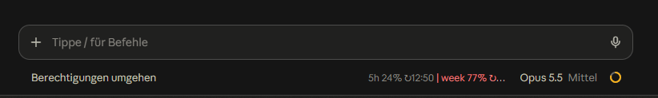
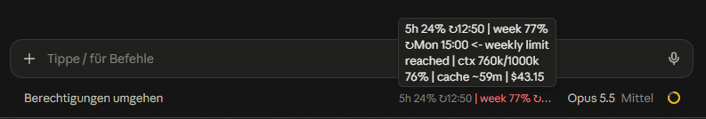

# usage-clock in the Claude desktop app

The desktop app does not show the `statusLine` from `settings.json`. This folder is a Claude Code plugin (a mod with
a hooks module) that draws the usage-clock line under the prompt instead, and that adds `/report`, a pane with the
usage report ([below](#the-usage-report-report)):

```
5h 17% ↻12:50 | week 76% ↻Mon 15:00 <- week gate: agents warn | ctx 340k/1000k 34% | cache ~54m | $3.50
```



The footer is shared with the permission mode and the model, so a narrow window cuts the line. Pointing at it shows
all of it:



## Install

```
claude plugin marketplace add inoX-Network/claude-code-usage-clock
claude plugin install usage-clock-display@usage-clock
```

Start a new session (or `/reload-plugins`). From a local checkout, `claude plugin marketplace add <path to the
checkout>` loads the plugin in place, so edits take effect at the next session start.

## What it shows

The parts, texts and colours of the [status line](../README.md#what-the-status-line-shows), with two differences:

- **Cache clock is an estimate.** A plugin learns when the last answer of the main session came, not when the prompt
  cache expires. The clock counts one hour (the cache of a Claude subscription) from that answer and marks the
  estimate with `~`. With an API key the cache lives five minutes, so the clock then runs too long.
- **Cost** of the session follows at the end, in grey.

The numbers come from Claude Code itself (`$.session.usage()`), not from `rate-limit.json`.

In the terminal the plugin draws no line: the status line shows the same there. `/report` works in both.

## The usage report: /report

`/report` opens a pane with the numbers of `tools/usage_report.py`: what a day, a week, a month or a year of usage
went into. `/report month` opens it on that period (`day`, `week`, `month` or `year`; without an argument, or with
another word, it is the week).

```
[Overview] Agents  Models  Cache/Thinking  Tokens  Projects     Day  Week  Month  Year  Refresh
 <- keys a b c d e f: the view                                  <- keys 1 2 3 4: the period, r: read again

Week to Mon 19 Oct 09:00 · 39 % of the weekly limit used (+39 points) · 100 USD at API prices
5h windows: 1, highest 82 % (Tue 13 Oct 14:30)

project                   USD  share  ~week pts  sessions
webshop                    60   60 %       20.0         1
...
```

The open view is a highlighted tab, the period is in the accent colour. Each surface shows the key of a button itself:
the terminal in front of it (`b: Agents`), the desktop app beside the label. The tabs are a row of buttons, because
Claude Code has no tab element and a mod cannot bind the arrow keys: Tab walks the buttons and opens the view it lands
on, Up and Down scroll a long view, a period is chosen by its key or with Enter (Tab does not read every period it
passes). The share of the weekly limit and the highest 5h window are yellow or red from the `statusline` thresholds of
the usage-clock `config.json`, as in the status line. Esc closes the pane. Tab past the last button hands the keys back
to the prompt (the engine's rule); Ctrl+X then Tab takes them into the pane again.

| View | Shows |
|---|---|
| Overview | The text overview of the report: period, share of the weekly limit, 5h windows, the projects with the highest cost, main and subagents, the models, the start, what is notable. |
| Agents | `main` and each agent type: USD, requests and the estimated points of the weekly and of the 5h limit. |
| Models | Each model: USD, requests, share of thinking in the output, cache hits; a model without a price has no USD. |
| Cache/Thinking | Cache hit rate, cold starts, thinking tokens and their share of the output. |
| Tokens | Input, cache write (5 minutes, 1 hour), cache read and output tokens. |
| Projects | Every project: USD, share, estimated points of the weekly limit, sessions. |
| Sessions | Every session of the period, highest cost first; `▶` marks the session you opened `/report` from. Enter on one opens its detail: cost and estimated points, tokens by kind, models, subagents, and what its context held after the first answer (see below). `q` goes back to the list. |

**In the desktop app the report is drawn as tiles** (the terminal keeps the text). The Overview shows four key
figures (the weekly limit as a half circle with a mark where red starts, the highest 5h window with a column per
window, the cost split into main and subagents, the cache hit rate), then the projects, the models, main and the agents
as bars, and what is notable with a tag (`GATE`, `CACHE`, `RISE`, `5H`). Sessions shows one card per session; the
session `/report` was opened from comes first, under "This session", its card toned and framed in the accent colour and
marked `LIVE`; its detail shows cost, requests, cache and thinking as key figures, then tokens, models, subagents and
what its context held as bars (the ten largest of each, then one bar for the rest). Agents shows main and the
subagents as key figures and every agent as a bar; Models a key figure per model and the share of the cost; Cache/
Thinking four key figures; Tokens one per kind and their bars; Projects every project as a bar. The tiles carry a dark ground of their own, so they read the
same in a light and a dark app, and the pane can be dragged wider or narrower: one tile per row below 44 columns, two
up to 95, four from 96 on. A Button of the desktop holds text only, so a session opens by its name, not by a click on
the whole card.

Every number is that of `usage_report.py --json`, and [`docs/report-format.md`](../docs/report-format.md) says what it
means and whether it is measured or an estimate (`~`).

- **Where the report comes from.** The plugin starts `usage_report.py --<period> --json` once per period and keeps the
  answer while the pane is open. Switching the period or the view does not read again; `r` does, for the period shown.
  A new `/report` starts from the beginning. While the report is read the pane says `loading…`.
- **Which Python.** The one that runs your status line: the plugin takes the interpreter and its options from the
  `statusLine` command in `settings.json`, as it does for the usage file, and looks for `usage_report.py` in the folder
  of `statusline.py`. `tools/install.py` puts both there. The command runs only if it starts an interpreter with
  exactly one `statusline.py` and contains no shell syntax.
- **When it fails.** The pane shows one line with the reason: no usage-clock status line in `settings.json`, the report
  not installed (run `tools/install.py`), a report that exited with an error or printed no JSON, a format number
  (`schema_version`) other than 1. In the first two cases nothing is started.
- **The model sees nothing.** The command answers with no text and no context, so the pane is neither a line of the
  transcript nor input of the model. The report reads local files only and makes no model call.

## It writes down what a context holds

The transcripts keep only the sum of the tokens of each request, not what the context consisted of. So after the first
answer of each session the plugin asks Claude Code once for the breakdown `/context` shows (`$.session.usage({
breakdown: 'full' })`: one token count per tool and memory file, as `/context` does) and writes it to
`<log_dir>/context-breakdown/<session id>.json`: the categories (system prompt, tools, MCP tools, memory files, skills,
messages), every MCP tool by server, every memory file, skill and agent, each with its tokens. Names and numbers only,
never content. `log_dir` is that of the hooks (`CCUC_LOG_DIR`, else `log_dir` of `config.json`, else
`~/.cache/claude-usage-clock`). The Sessions view and `usage_report.py --session` show it. Deferred categories and MCP
tools (listed with their size, loaded only when used) are marked `deferred`: their tokens are not part of the total.
Sessions before plugin 0.4.0 have none; subagents are not measured on their own. After `/clear` Claude Code starts the
new session without `session.start`, so the first answer reads `config.json` and the log folder itself (before 0.5.2
the file went to a folder named `~` below the working directory). With no home directory known (`HOME`,
`USERPROFILE`) nothing is written. The plugin cannot set file modes: the file is as private as the log folder, which
the hooks create with mode `0700`.

## It writes the usage file, too

The hooks and gates read their usage from the shared usage file (`~/.claude/rate-limit.json`), and only the status
line writes it. The app never runs the status line, so without the plugin a desktop session leaves the file alone and
the hooks see `STALE` or `unknown`.

After each answer (Claude Code's `session.measure`) the plugin therefore hands the app's numbers to the installed
`statusline.py`, in the shape of the status line's own input, and discards the line it prints. The same code merges
them with what other sessions wrote, under the same lock, adds at most one line to the measurement history and saves
the context state of the session for the context reporter. A terminal session and a desktop session can run side by
side.

- The command is the `statusLine` from `settings.json` that `tools/install.py` writes. It runs only if it starts an
  interpreter with exactly one `statusline.py` and contains no shell syntax (`|`, `;`, `&&`, `$`, ...), so another
  status line is never run. Without it the plugin still draws its line, and the hooks keep seeing `unknown`.
- A session with a terminal attached runs nothing: the status line writes there, with the exact cache clock.
- The app tells a plugin no cache expiry, so a desktop session saves no cache clock: the wake-up watcher has nothing to
  wake there.

## Configuration

The colours follow the `statusline` section of the usage-clock `config.json` (`yellow_from`, `red_from`,
`week_stop_marker`, `show_reset`, `context_yellow_from_k`, `context_red_from_k`, `cache_yellow_below_min`) and
`thresholds.start_block_week` and `thresholds.week_action` for the week gate marker (`<- week gate: agents warn`, `ask`
or `blocked`). The file is read once per session start. A missing
file or a key with the wrong type means the default, as for the hooks.

The plugin option `config_file` names the file (default `~/.claude/hooks/usage-clock/config.json`, where
`tools/install.py` puts it). Change it under `/config` or with
`claude plugin install usage-clock-display@usage-clock --config config_file=<path>`.

## Tests

```
claude plugin validate desktop
claude plugin test desktop
```

The tests of the pane run on the terminal and on the desktop surface, against a fixed example of
`usage_report.py --json` (`hooks/report-fixture.ts`) and with no process started.

The CI runs both on Linux and Windows (job `plugin` in `.github/workflows/tests.yml`), with the Claude Code version
pinned there: the plugin API and its test engine come with it, so raise it there when the plugin needs a newer one.
They need no login.

`tsconfig.json` extends the types Claude Code writes beside the manifest (`.claude-plugin/types/`) the first time
it loads the plugin from a folder; until then an editor shows the `claude-code` imports as unresolved.
