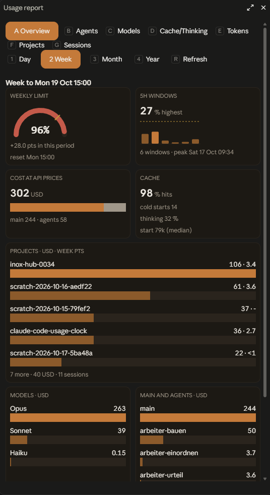
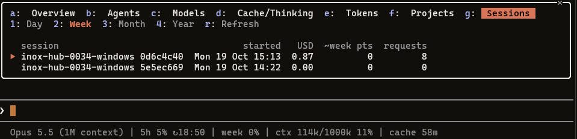

# Usage reports

[README](../README.md) · [All documentation](README.md)

## Reports: what was used

`tools/usage_report.py` shows what was used in a day, a week or a month, in total and per CLI. It reads the Claude
Code transcripts (`~/.claude/projects`, or `--projects-dir`; `--claude-dir` names another user folder of Claude Code,
`--config` another `config.json` for the log folder), the measurement history and the log of the gates, and
never message text: per request only the token counts, the model, the time, the working folder (its last name labels
the CLI), the ids that tell requests apart and, for a subagent, its agent type.

```sh
python3 tools/usage_report.py                       # today, as an overview
python3 tools/usage_report.py --day 2026-01-14
python3 tools/usage_report.py --week                # the subscription week, up to the weekly reset time
python3 tools/usage_report.py --month 2026-01
python3 tools/usage_report.py --year 2026           # the days of the year (this year: up to today)
python3 tools/usage_report.py --since 2026-01-05 --until 2026-01-11
python3 tools/usage_report.py --week --project shop     # the details of one project (as in --full) and their sum
python3 tools/usage_report.py --week --session 5f3a     # the details of one session (any start of its id), with the split of its context
python3 tools/usage_report.py --week --full             # every figure
python3 tools/usage_report.py --json                # the same figures for other tools, the overview included
python3 tools/usage_report.py --archive             # see docs/usage-report.md
```

The installer copies the report, `log_summary.py` and `prices.json` to `~/.claude/hooks/usage-clock/` as well, so you
can run it without this checkout, from any folder, with the same switches:

```sh
python3 ~/.claude/hooks/usage-clock/usage_report.py --week
```

Run `tools/install.py` again after a `git pull` to update the installed copy; `install.py --check` names a report
file that is missing or older than the checkout.

### The overview

Without a switch the report is an overview that anyone can read at a glance, about 20 lines. An example, with
invented numbers (every column and line is explained in [`docs/report-format.md`](report-format.md)):

```
Week to Mon 19 Oct 09:00 · 39 % of the weekly limit used (+39 points) · 100 USD at API prices
5h windows: 1, highest 82 % (Tue 13 Oct 14:30)

Where it went            USD   share  ~week pts  sessions
  0016                    60    60 %       20.0         1
  0034                    29    29 %       18.0         2
  0022                   6.0     6 %         <1         1
  0050                   3.0     3 %         <1         1
  0051                   1.5     1 %         <1         1
  2 more                0.75    <1 %         <1         2

Main 75 USD · subagents 25 USD (top: stripe-meister 20 USD)
Opus 92 USD · Sonnet 8.0 USD · Haiku 0.75 USD · thinking 25 % of output · cache hits 89 %
Start: main 45k tokens (median), subagents 36k-61k (median per type)

Notable
  spawn gate denied 2 agent starts (5h window at N %: 2)
  spawn gate asked before 1 agent start (7-day window at N %: 1)
  soft stop denied 4 subagent tool calls (checkpoint due: 3, usage pause: 1)
  soft stop would have denied 2 subagent tool calls (checkpoint due: 2; shadow mode, nothing was blocked)
  one 5h window reached 82 % (Tue 13 Oct)
  cache hits under 90 %: 0034 80 %
  0016 made 60 % of the cost (60 USD)

Details: --project 0016 · --session aaaaaaaa · --full
```

A `-` in a points column means the points of that row are not measured: none of its cost lay in a counted section of
that limit, which is not the same as 0 (`measured_share` in [`docs/report-format.md`](report-format.md)).

What every part of the overview and of the full report (`--full`) means, the details switches and the day archive
are in [`docs/usage-report.md`](usage-report.md); every line and JSON field in
[`docs/report-format.md`](report-format.md).

### The /report pane

The plugin in [`desktop/`](../desktop/README.md) (install it as in [In the Claude desktop app](statusline.md#in-the-claude-desktop-app))
adds `/report`, in the desktop app and in the terminal. It opens a pane with the same numbers, read from the report
script that `tools/install.py` installs.



- `/report month` opens it on that period (`day`, `week`, `month` or `year`; the default is the week).
- Seven views, each on a key: `a` Overview, `b` Agents, `c` Models, `d` Cache/Thinking, `e` Tokens, `f` Projects,
  `g` Sessions. The period is on `1` to `4`, `r` reads it again, Esc closes the pane.
- The desktop app draws tiles and bars, the terminal the same numbers as text.
- Sessions lists every session of the period, highest cost first, and marks the one you opened `/report` from: `▶` in
  the terminal, under "This session" in the app. A session opens into its detail (cost, tokens by kind, models,
  subagents and [what its context held](#what-a-session-started-with) after the first answer); `q` goes back.



The pane makes no model call, and nothing of it reaches the model or the transcript. Every key, tile and failure
message: [`desktop/README.md`](../desktop/README.md#the-usage-report-report).

### What a session started with

The transcripts hold only the sum of each request, not what the start of a session consisted of. The desktop plugin
([`desktop/`](../desktop/README.md)) therefore measures it: once per main session, after its first answer, it writes how the
context was made up (the split `/context` shows: categories, every MCP tool, memory files, skills, agents) to
`<log_dir>/context-breakdown/<session id>.json`, by default `~/.cache/claude-usage-clock/context-breakdown/`. Only names
and token counts are written, never the text of a prompt, a file or a tool. It is recorded from the installation of the
plugin on, not backwards: older sessions have no file, and subagents have none either.

The report reads those files for the sessions of the period. `--session` prints the split as the block *Context after the
first answer*, and `--json` has it as `clis[].context` (`null` without a file). A file that cannot be used is counted in
`coverage.unreadable_context_files` and does not stop the report.

```
Context after the first answer (session 5f3a9c21, shop, measured 2026-01-14T08:02:31Z)
  64,200 of 1,000,000 tokens (6.4 %), model claude-opus-5-5, detail full
  Categories
    System prompt: 3,200
    System tools: 11,400
    MCP tools: 9,000
    Memory files: 2,200
    Skills: 1,200
    Custom agents: 750
    Messages: 36,450
    Free space: 935,800
  MCP servers: 9,000 tokens in 2 servers
    github: 8,600 tokens, 2 tools
      list_issues: 4,700
      create_issue: 3,900
    docs: 400 tokens, 1 tool
      query: 400
  Memory files: 2,200 tokens in 2 files
    ~/.claude/CLAUDE.md (user): 1,500
    /home/u/Projekte/shop/CLAUDE.md (project): 700
  Skills: 1,200 tokens, 2 of 3 included
    api-design: 700
    testing-tdd: 500
  Agents: 750 tokens in 2 agents
    reviewer (user): 450
    architect (user): 300
```

The fields of the file and of `context` are explained in [`docs/report-format.md`](report-format.md).

### Ask your agent about your usage

The JSON is made for an agent to read: [`docs/report-format.md`](report-format.md) explains every field (its unit,
where it comes from, whether it is measured or estimated). Give your agent that file and the output, for example:

> Read `docs/report-format.md` in the claude-code-usage-clock folder. Then run
> `python3 tools/usage_report.py --week --json` and tell me in plain words where my usage went this week: which
> projects cost the most, and whether anything in `overview.notable` needs my attention. Say which numbers are measured
> and which are estimates.

The report reads only local files: the Claude Code transcripts (numbers only, never message text), the measurement
history, the day archive and the log of the gates. It makes no model call and sends nothing anywhere; your agent sees
the same numbers you do.
